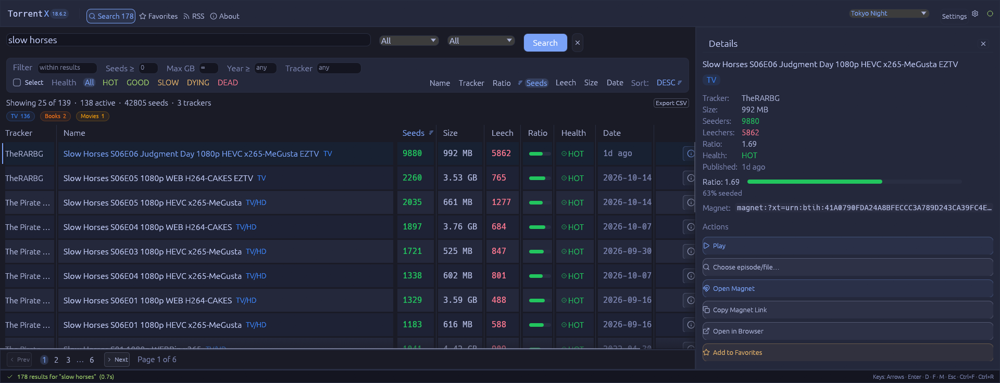

# TorrentX

**Native Rust desktop torrent search app** — query all your [Jackett](https://github.com/Jackett/Jackett) indexers from one blazing-fast GUI.

[](https://github.com/chethan62/torrentx/releases/latest)
[](https://github.com/chethan62/torrentx/actions/workflows/ci.yml)
[](LICENSE)
[](GUIDE.md)

## Screenshots

| Dark (Tokyo Night) | Light (Catppuccin Latte) |
|--------------------|--------------------------|
|  |  |

*19 themes total — 16 dark + 3 light, instant switching.*

## Features

- **19 themes** — 16 dark + 3 light, instant switching
- **All Jackett indexers** — search 100+ trackers simultaneously, or pick one;
  results stream in as each tracker answers instead of waiting for the slowest
- **Multi-column results** — Name, Tracker, Size, Seeds, Leechers, Ratio, Health, Date (toggle any in Settings → Columns)
- **Row density** — Compact / Normal / Roomy
- **Filters** — text search, min seeds, size range, year, tracker, health status, category chips
- **Sort** — by Name, Tracker, Size, Seeds, Leechers, Ratio, Date
- **Favorites** — save torrents with timestamps, search filter, persistent storage
- **Detail panel** — seeder/leecher ratio bar, magnet copy/open, .torrent download
- **Direct play** — stream a result to mpv/vlc without downloading the whole torrent;
  multi-file packs get an episode picker (filterable file list) and a Stop control
  (needs [webtorrent-cli](https://github.com/webtorrent/webtorrent-cli): `npm install -g webtorrent-cli`;
  its output, including the peer count, goes to `~/.cache/torrentx/webtorrent.log`)
- **Batch actions** — select mode, select-all, copy N magnets at once
- **Keyboard shortcuts** — ↑↓ Enter D F M P Ctrl+F Ctrl+R Esc
- **CSV export** — export filtered results
- **Pagination** — 25/50/100/All
- **Deduplication** — across trackers (main search + RSS)
- **Search history** — with per-item delete
- **RSS feeds** — Jackett Torznab indexer feeds with auto-refresh (10 min), deduped
- **Custom accent color** — override any theme's accent
- **System tray** — show/hide + quit from the tray menu (on Wayland, where a
  window cannot be restored by the app itself, the item minimizes instead)
- **Desktop notifications** — alerted when a search completes
- **`--config <path>`** — portable config for multiple profiles/installs
- **Update checker** — notifies when a new release is out (opt-out in Settings)
- **Toast notifications** — animated, per-theme colored
- **egui 0.36** — modern rendering, GPU-accelerated

## Download

One command, checksum-verified, AppImage into `~/Applications`:

```bash
curl -fsSL \
  https://github.com/chethan62/torrentx/raw/main/scripts/install.sh \
  | sh
```

`INSTALL_DIR=/somewhere sh scripts/install.sh` installs elsewhere; the script resolves the
latest release, downloads its `sha256sums.txt` and refuses to install on a mismatch.
With the piped form the variable has to sit on the **`sh`** side — `INSTALL_DIR=/opt/tx curl … | sh`
only sets it for `curl` and installs to `~/Applications` anyway:

```bash
curl -fsSL \
  https://github.com/chethan62/torrentx/raw/main/scripts/install.sh \
  | INSTALL_DIR=/opt/tx sh
```

For a system-wide copy run it as root and keep `INSTALL_DIR` on the command side of `sudo`,
otherwise `sudo`'s `HOME=/root` sends the file to `/root/Applications`:

```bash
curl -fsSL \
  https://github.com/chethan62/torrentx/raw/main/scripts/install.sh \
  | sudo INSTALL_DIR=/opt/tx sh
```

Run as root with `INSTALL_DIR` unset and the installer says so on stderr before it downloads —
naming `/root/Applications` as the destination — then installs there anyway. It warns rather than
refuses, because a root install to `/opt` is a legitimate thing to want; the silent part is what it
refuses to be.

Or grab the file yourself from the [releases page](https://github.com/chethan62/torrentx/releases/latest):

| Platform | File | Size |
|----------|------|------|
| Linux (AppImage) | `TorrentX-<version>-x86_64.AppImage` | ~17 MB |
| Linux (binary) | `torrentx` | ~36 MB (stripped, thin LTO) |

Windows builds and **launches** on a real Windows runner in CI
(`.github/workflows/windows-native.yml`) but is not published — no interactive
pass has been done there, so releases ship Linux only.

## Build from source

```bash
# Prerequisites: Rust 1.82+, cargo
cargo build --release
# Binary: target/release/torrentx
```

## Setup

1. Launch TorrentX
2. Click ⚙ **Settings**
3. Enter your Jackett URL (default: `http://localhost:9117`) and API Key
4. Start searching

📖 **Full documentation**: [GUIDE.md](GUIDE.md) — installation, filters,
RSS, settings reference, config file, troubleshooting, and privacy notes.

## Tech

- **GUI:** egui 0.36 + eframe (GPU-accelerated via wgpu, software-GL fallback)
- **HTTP:** reqwest (blocking)
- **Config:** `~/.config/torrentx/config.json`
- **Binary size:** ~36 MB stripped + thin LTO; ~17 MB packed as AppImage (measured)
- **Build speed:** thin LTO keeps release rebuilds parallel — see [docs/build-performance.md](docs/build-performance.md) for the measurements

### Bundled icons

`assets/icons/*.svg` are [Lucide](https://lucide.dev) glyphs (ISC licence, ©
Lucide Contributors), pinned to lucide-static 1.61.0 and re-tintable via
`stroke="currentColor"`. `assets/icons/update-icons.sh <version>` refreshes
them; `assets/icons/README.md` has the details.

## License

Dual-licensed under **MIT OR Apache-2.0** © [chethan62](https://github.com/chethan62) —
use whichever suits you; Apache-2.0 adds an explicit patent grant.

Every licence the binary carries ships with it — under `usr/share/licenses/torrentx/` in the
AppImage and tarball you will find `MIT.txt`, `Apache-2.0.txt`, `NotoSansCJK-OFL.txt` and
`Lucide-ISC.txt`. `cargo deny` gates the dependency tree against the allow-list in
[`deny.toml`](/chethan62/torrentx/blob/main/deny.toml) in CI.

Paths below are relative to the repo root and to the same directory in the AppImage.

| Part | Licence | Notice file |
| --- | --- | --- |
| TorrentX source and binary | MIT OR Apache-2.0 | `LICENSE-MIT`, `LICENSE-APACHE` |
| `NotoSansCJK*-subset.otf` (modified Noto CJK subsets) | OFL-1.1 | `NotoSansCJKjp-subset.LICENSE.txt` |
| `icons/*.svg` (Lucide 1.61.0) | ISC | `Lucide.ISC.LICENSE.txt` |

### Bundled fonts

Torrent titles are often Japanese, Chinese or Korean, so two font subsets are
embedded in every build (`include_bytes!` in `src/app.rs`) and used as per-character
fallbacks after egui's Latin font:

| File | Covers | Size |
|------|--------|------|
| `assets/NotoSansCJKjp-subset.otf` | Han (CJK Unified Ideographs), hiragana, katakana, CJK/fullwidth punctuation | 4.9 MB |
| `assets/NotoSansKR-subset.otf` | Hangul syllables and jamo | 1.1 MB |

They are single-face `.otf` files because egui's `ab_glyph` cannot select a face out of
a system `.ttc` collection — the app therefore needs no CJK fonts installed. Together
they are 6.0 MB of the binary, down from 9.2 MB for the previous JP-only subset, which
also left Korean titles as □□□□ (the JP face contains no Hangul).

Both are subsets of **Noto Sans CJK 2.004** (Adobe/Google, derivative of Source Han
Sans) under the **SIL Open Font License 1.1** — © 2014-2021 Adobe; "Noto" is a
trademark of Google Inc. A subset is a *modified* version, and the copyright notice,
the licence, the modification evidence (the upstream faces declare **no** Reserved
Font Name) and the exact `pyftsubset` commands ship at
[`assets/NotoSansCJKjp-subset.LICENSE.txt`](assets/NotoSansCJKjp-subset.LICENSE.txt).
A unit test asserts the promised scripts resolve to real glyphs, and the same notice is
viewable in **About → Bundled font licence** (the release artifacts are a bare binary and
an AppImage, so the text ships inside both).
