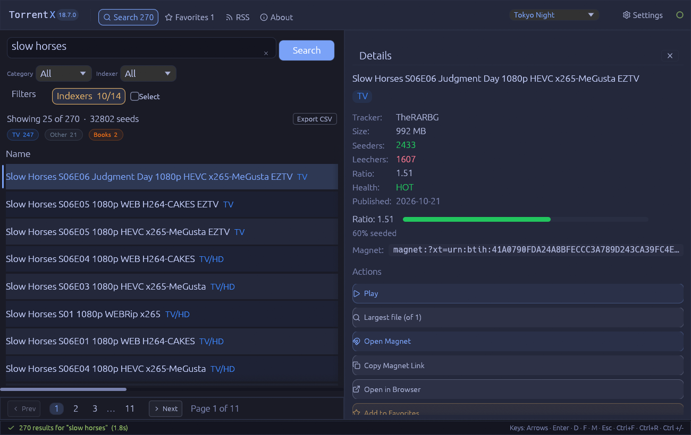
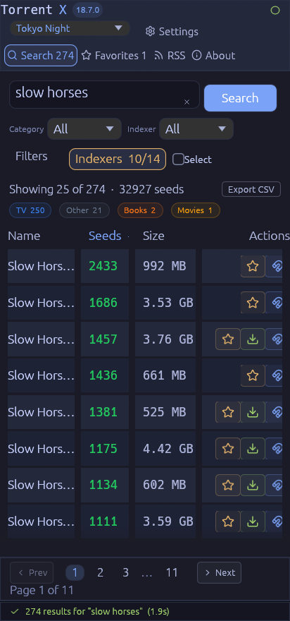
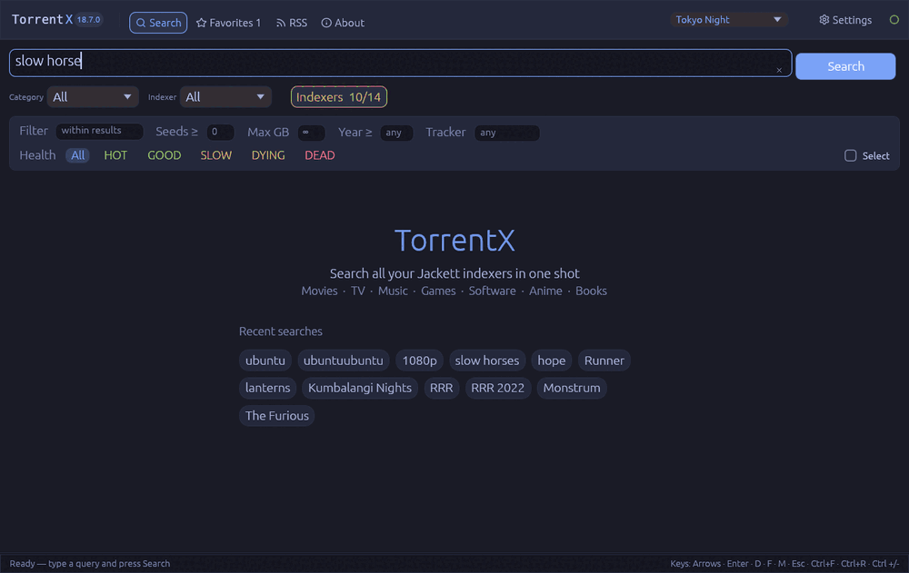
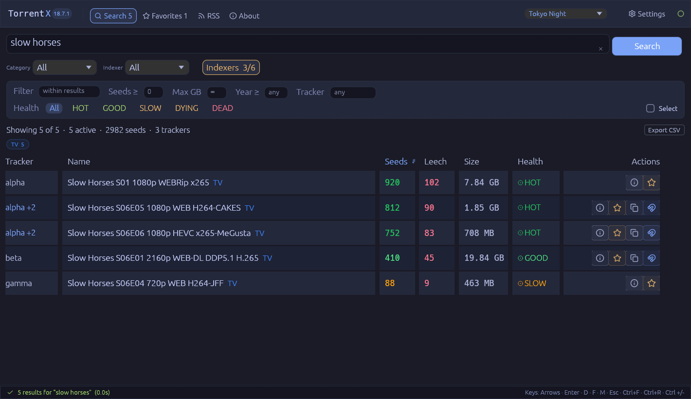
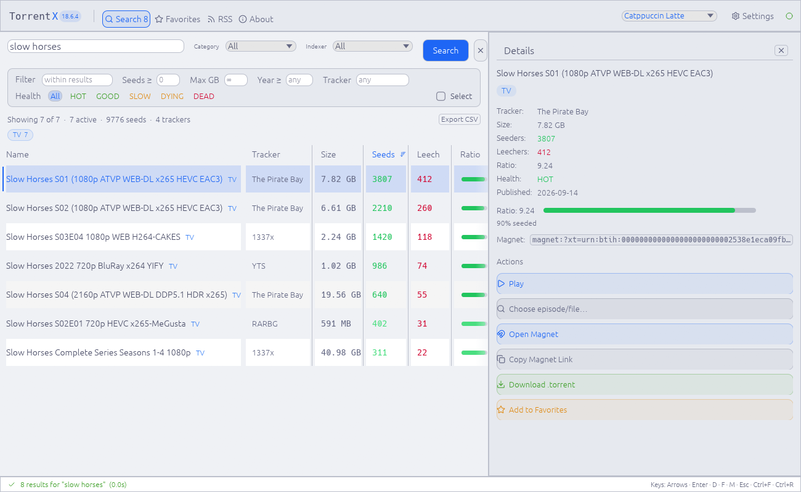

# TorrentX

**Torrent search for the desktop, in Rust.** One window over your Jackett indexers *or* the two
sources built in (`apibay`, `knaben`), with results streaming in per tracker as each one answers.
Native egui — no Electron, no browser, ~17 MB AppImage.

[](https://github.com/chethan62/torrentx/releases/latest)
[](https://github.com/chethan62/torrentx/actions/workflows/ci.yml)
[](LICENSE)
[](GUIDE.md)

**Contents** · [Screenshots](#screenshots) · [Why TorrentX](#why-torrentx) · [Features](#features) ·
[Requirements](#requirements) · [Download](#download) · [Setup](#setup) · [Usage](#usage) ·
[Build from source](#build-from-source) · [Platforms](#platforms) · [Tech](#tech) ·
[Contributing](#contributing) · [License](#license) · [Disclaimer](#disclaimer)

## Screenshots

A search with the detail panel open: per-tracker rows, health bands, and the magnet/file list for the
selected release. The layout reflows under 720 pt — the table keeps Name, Seeds and Size, the detail
panel becomes an overlay — so the same build runs on a phone.

| Desktop — 1300 pt | Phone width — 412 pt |
|---|---|
|  |  |

Results stream in per tracker instead of arriving all at once at the end:



The same release listed by several indexers is one row: `alpha +2` means two more trackers carry it,
and hovering names them.



<sub>Shot against a stub Jackett: live indexers rarely overlap on page 1, so `+2` is easier to spot
than to catch.</sub>

<details>
<summary>Light theme (Catppuccin Latte)</summary>



</details>

## Why TorrentX

- **vs the Jackett web UI** — a real table (sort, resize, filters, favourites, batch copy) instead of
  a page you reload per query, and each tracker's rows appear as it answers rather than at the end.
- **vs Prowlarr** — Prowlarr feeds *other* apps; this is the search client itself.
- **vs qBittorrent's search plugin** — its own window, keyboard-driven, and it can hand a result
  straight to a player.

## Features

**Search**

- All Jackett indexers at once (100+ trackers), or one picked from the Indexer menu
- Two built-in sources, `apibay` and `knaben` — Jackett is a source, not a requirement
- Your own indexers as files: one JSON definition per site in `~/.config/torrentx/indexers/`
- Results stream in per tracker; the status bar names any tracker that failed
- **Same torrent on several trackers is one row** — grouped by infohash, best-seeded copy shown, `Tracker +2` names the rest
- Deduplication across trackers (search and RSS), search history with per-item delete

**Results and filtering**

- Multi-column table — Name, Tracker, Size, Seeds, Leechers, Ratio, Health, Date (toggle in Settings → Columns)
- Filters: text, min seeds, max size, year, tracker, health status, category chips
- Sort by any column, drag separators to resize, three row densities (Compact / Normal / Roomy)
- Pagination 25/50/100/All, CSV export, batch select + copy N magnets

**Playback and picking**

- Detail panel: seeder/leecher ratio bar, health, magnet copy/open, `.torrent` download, file list
- **Send to qBittorrent** — one click hands the magnet to your client's Web API (URL/user/pass in Settings)
- Direct play — stream to **mpv** or **vlc** through `webtorrent-cli`, with an episode picker for packs
- Favourites with timestamps; RSS feeds (Jackett Torznab) with 10-minute auto-refresh

**App and desktop**

- 19 themes plus a custom accent colour
- Keyboard-driven (see [Usage](#usage)); interface scaling for HiDPI
- System tray, a notification when a search finishes, release-update check (opt-out)
- `--config <path>` for a portable profile; `--minimized` to start in the tray

## Requirements

| Need | Why | Optional? |
| --- | --- | --- |
| Linux x86-64, X11 or Wayland desktop | the published build | no |
| `curl` | the install command pipes a script into `sh` | no |
| Write access to `~/Applications` | default install dir; `INSTALL_DIR` overrides | no |
| [Jackett](https://github.com/Jackett/Jackett) running locally | the classic multi-indexer search. API key: Jackett's dashboard, top-right — paste it in Settings | **yes** — `apibay` and `knaben` need nothing |
| [`webtorrent-cli`](https://github.com/webtorrent/webtorrent-cli) on `PATH` | fetches torrent metadata for the file list and streaming | yes — Direct play only |
| `mpv` or `vlc` on `PATH` | plays the stream | yes — Direct play only |

No GTK, appindicator or `xdotool` libraries are needed: the tray is published over D-Bus.

## Download

One command — resolves the latest release, verifies it against that release's `sha256sums.txt`,
and installs the AppImage to `~/Applications`. Re-running it upgrades in place.

```bash
curl -fsSL \
  https://github.com/chethan62/torrentx/raw/main/scripts/install.sh \
  | sh
```

<details>
<summary>Installing elsewhere, as root, or without piping to a shell</summary>

**Another directory** — the variable has to sit on the `sh` side of the pipe, or only `curl` sees it:

```bash
curl -fsSL \
  https://github.com/chethan62/torrentx/raw/main/scripts/install.sh \
  | INSTALL_DIR=/opt/tx sh
```

**System-wide** — the same, under `sudo`. `INSTALL_DIR` must be set, because `sudo` resets `HOME` to
`/root` and the file would land in `/root/Applications`. Running as root *without* `INSTALL_DIR`
prints a warning naming that path, then installs there anyway.

```bash
curl -fsSL \
  https://github.com/chethan62/torrentx/raw/main/scripts/install.sh \
  | sudo INSTALL_DIR=/opt/tx sh
```

**By hand, no installer** — take the archive and `sha256sums.txt` from the
[releases page](https://github.com/chethan62/torrentx/releases/latest), then check before running:

```bash
sha256sum -c sha256sums.txt --ignore-missing
chmod +x TorrentX-*-x86_64.AppImage
```

</details>

| Platform | File | Size |
|----------|------|------|
| Linux (AppImage) | `TorrentX-<version>-x86_64.AppImage` | ~17 MB |
| Debian / Ubuntu | `torrentx_<version>_amd64.deb` | ~18 MB |
| Fedora / openSUSE | `torrentx-<version>-1.x86_64.rpm` | ~18 MB |
| Linux (binary) | `torrentx-v<version>-x86_64-linux.tar.gz` | ~17 MB |
| Windows (x64) | `TorrentX-<version>-windows-x64.zip` | ~14 MB (static CRT) |

The `.deb`/`.rpm` put the binary in `/usr/bin`, with the desktop entry, icon and metainfo, so the app
appears in the launcher. They are **built on Ubuntu 24.04**, so they need glibc ≥ 2.39 — on anything
older (Debian 12, Ubuntu 22.04) use the AppImage, which carries its own runtime.

Windows builds are compiled, packaged and **launched** on a Windows runner in CI
(`.github/workflows/windows-native.yml`), but have not been driven by hand on Windows hardware —
treat the exe as tested-by-CI only. No macOS build exists.

> **On `curl | sh`:** the checksum comes from the same release as the binary, so it catches a
> corrupted download, not a compromised release. If that matters to you, use the manual path above,
> or build from source.

## Setup

1. **Install** — the one command in [Download](#download).
2. **Run it.**

   ```bash
   ~/Applications/TorrentX.AppImage
   ```

3. **Search.** Type a query, press `Enter`. The built-in sources work with no configuration.

4. **Add Jackett (optional).** ⚙ **Settings** → Jackett URL (default `http://localhost:9117`) and API
   Key → save. Its indexers join the same fan-out; the Indexers chip shows how many are enabled.

📖 **Full documentation**: [GUIDE.md](GUIDE.md) — every filter, RSS, settings reference, config file,
troubleshooting and privacy notes.

## Usage

1. **Search** — type a query and press `Enter`. Rows appear per tracker as each one answers; the
   status bar names any tracker that failed.
2. **Narrow it** — set Category and Indexer, then `Filters` (text, min seeds, max GB, year, tracker,
   health) and the category chips. Click a header to sort, drag a column separator to resize.
3. **Inspect** — click a row: the detail panel shows tracker, size, ratio, health, the magnet and the
   file list.
4. **Act on the selection** — `M` opens the magnet, `P` streams it (mpv or vlc, via
   `webtorrent-cli`), `F` saves it to Favorites.
5. **Come back later** — Favorites and RSS are their own tabs; `Esc` closes the panel and `Ctrl+R`
   re-runs the last search.

| Key | Does |
| --- | --- |
| `↑` `↓` | Move the selection |
| `Enter` / `M` | Open the magnet for the selected row |
| `D` | Toggle the detail panel |
| `F` | Favorite the selected row |
| `P` | Stream the selected row (needs `webtorrent-cli` on `PATH`) |
| `Esc` | Close the detail panel / clear the query |
| `Ctrl+F` | Focus the search field |
| `Ctrl+A` / `Ctrl+C` | Select all visible rows / copy the magnet |
| `Ctrl+R` | Re-run the last search |
| `Ctrl` `+` / `−` / `0` | Scale the interface up / down / back to 100% |

Shortcuts don't fire while you're typing in a field.

### Your own indexer, in one file

Drop this in `~/.config/torrentx/indexers/mysite.json` and restart the app — it appears in the
Indexer menu and rides the same fan-out as everything else (dedupe, health bands, sort, categories):

```json
{
  "id": "mysite",
  "name": "My Site",
  "category": "TV",
  "url": "https://api.example.org/search?limit=100&q={q}",
  "rows": "results",
  "fields": {
    "title": "name",
    "magnet": "magnet",
    "size": "size_bytes",
    "seeders": "seeds",
    "leechers": "peers",
    "date": "published_unix"
  }
}
```

`{q}` is the query (JSON-escaped when it goes into a POST body), `rows` is a dotted path to the
array, and each field is a dotted path inside a row. `magnet` may be omitted when the site returns
only `hash`; `headers` adds fixed headers and reads `${VAR}` from the environment at request time —
where an API key goes. `assets/indexers/eztv.json` is a working example.

## Build from source

```bash
# Rust 1.85+ (edition 2024). Debian/Ubuntu libraries:
sudo apt-get install -y libxkbcommon-dev libasound2-dev \
  libxcb-render0-dev libxcb-shape0-dev libxcb-xfixes0-dev \
  libxcb1-dev libssl-dev pkg-config
cargo build --release
# Binary: target/release/torrentx
```

Gates CI runs: `cargo fmt --all --check`, `cargo test --all-targets`,
`cargo clippy --all-targets --all-features -- -D warnings`, `./scripts/ui-standards.sh`,
`cargo deny …`. Build-time measurements live in
[docs/build-performance.md](docs/build-performance.md); the Android build (APK from the same source)
in [docs/android.md](docs/android.md).

## Platforms

| Platform | Status |
| --- | --- |
| Linux x86-64 (X11 / Wayland) | **Supported** — AppImage + tarball in every release |
| Android (arm64) | **Builds and runs** from the same source; the APK is not published — see [docs/android.md](docs/android.md). Player, tray, notifications and the single-instance socket are desktop-only |
| Windows x64 | **Published** as a static-CRT zip; launches in CI, not hand-tested on Windows |
| macOS | **Not supported** — no build, no CI job |

## Tech

- **GUI:** egui 0.37 + eframe (GPU-accelerated via wgpu, software-GL fallback)
- **HTTP:** reqwest (blocking)
- **Config:** `~/.config/torrentx/config.json`
- **Binary size:** ~36 MB stripped + thin LTO; ~17 MB packed as AppImage (measured)
- **Build speed:** thin LTO keeps release rebuilds parallel — measurements in
  [docs/build-performance.md](docs/build-performance.md)

## Contributing

Issues and pull requests are welcome — [open an issue](https://github.com/chethan62/torrentx/issues)
or send a PR. `main` requires a PR with a green `build + test + clippy` check; CI also reruns the
test suite 20× to catch flakes. Details in
[CONTRIBUTING.md](CONTRIBUTING.md). Minimum Rust: 1.85 (edition 2024).

## License

Dual-licensed **MIT OR Apache-2.0** © [chethan62](https://github.com/chethan62) — use whichever suits
you; Apache-2.0 adds an explicit patent grant. Every notice the binary carries (fonts, icons, the
dependency allow-list) is listed in [docs/licenses.md](docs/licenses.md).

## Disclaimer

TorrentX is a **search client**. It hosts no content and distributes nothing: it queries indexers
you configure and hands you a magnet link. What you do with a result is your responsibility —
downloading copyrighted material without permission is illegal in most jurisdictions.
